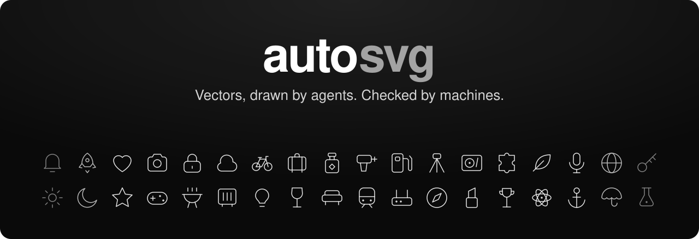

<p align="center">
  <a href="https://rawlings.github.io/autosvg/">
    
  </a>
</p>

<p align="center">
  <a href="https://rawlings.github.io/autosvg/"></a>
</p>

<p align="center">
  <a href="https://github.com/Rawlings/autosvg/actions/workflows/deploy.yml"></a>
  
  
  
  
  
  <a href="LICENSE"></a>
  <a href="https://github.com/Rawlings/autosvg/stargazers"></a>
</p>

<h3 align="center">An agentic suite for producing vectors.</h3>

<p align="center">
  Give an AI agent a canvas, a ruler and a pair of eyes, and it draws vectors that hold up at 16 pixels.<br>
  Every one measured, checked, looked at and fixed before it ships.
</p>

---

## Agents can write SVG. They just can't see it.

Ask a model for an icon and you get path data and a prayer. Maybe it is centred. Maybe two strokes touch at 16px and turn to mud. Nobody checked, because nothing was there to check.

**autosvg closes the loop.** It hands the agent a real 24 × 24 canvas and everything a designer would use on it:

<table>
  <tr>
    <td width="25%"><b>1. Draw</b><br>Parametric recipes and geometry helpers, so corners, circles and symmetry come out exact instead of approximate.</td>
    <td width="25%"><b>2. Measure</b><br>Bounds, centring, grid, cramped gaps, loose ends and near-copies of existing vectors, found in under a second.</td>
    <td width="25%"><b>3. Look</b><br>A headless browser renders the vector at 16, 24 and 48 px next to its neighbours, and plays its motion frame by frame.</td>
    <td width="25%"><b>4. Fix</b><br>The agent reads what the checks and its own eyes found, redraws, and goes round again until it is good.</td>
  </tr>
</table>

Humans get the same tools in the browser. Agents get them as an [MCP server](tools/src/mcp.ts) and a live JavaScript API. Same canvas, same checks, same standard.

## What you get

**303 vectors in 28 categories.** Interface, devices, shopping, home, nature, tools, play: a set that is already organised the way a shop catalogue is, with room to grow. [See the map.](STRUCTURE.md)

**Vectors that move, with no animation code.** Every vector carries its own choreography. Bells ring, lids hinge, a microphone mutes, a cloud uploads then finishes. It is all driven by two CSS numbers, so a hover, a scroll or a click is the whole integration. About 150 more names are simply the same vector in a state.

**One vector into any other.** Morph a sun into a moon, a menu into a cross, or anything into anything, shape to shape.

**A look you can change in one place.** Stroke weight, corner radius, squircles, caps, joins and a colour, applied across the library, the previews and the 3D view at once.

**A showcase that shows off.** Pick a vector and watch it turn in real 3D, sit in real places, and wear dozens of styles grouped by industry: finance, games, health, food, sport and more. All from the one plain SVG.

**Quality you can audit.** A page that judges the whole set: geometry, motion, accessibility, performance. Not a promise, a report.

**Plain SVG out.** Export every vector as a static SVG, a sprite or a manifest for anything that cannot run CSS: design tools, `` tags, masks.

## Try it

**Open the [live demo](https://rawlings.github.io/autosvg/)**, or run it yourself:

```bash
pnpm install
pnpm dev
```

Four pages: **Library** to browse and play with every vector, **Studio** to draw on the canvas with keylines and live checks, **Showcase** for the 3D and the styles, **Quality** for the whole-set audit.

## Use a vector

```html
<autosvg name="bell"></autosvg>
<autosvg name="mic" state="off"></autosvg>
```

That is a ringing, mutable microphone and a bell, themed by CSS variables and following your text colour. The full guide, with motion, state, morphing and export, is in [docs/USAGE.md](docs/USAGE.md).

> Motion and state use modern CSS (Chrome and Edge 133+). Elsewhere the vectors are shown still. The packages are not on npm yet, so for now you use it from this repo.

## Built for agents, by agents

- [AGENTS.md](AGENTS.md): how an AI agent works in this repo
- [SPEC.md](SPEC.md): the rules every vector has to pass
- [STRUCTURE.md](STRUCTURE.md): how the set is organised, and where the next vectors are needed
- [docs/USAGE.md](docs/USAGE.md): loading it, driving it, exporting it, working on it

## License

[MIT](LICENSE)
